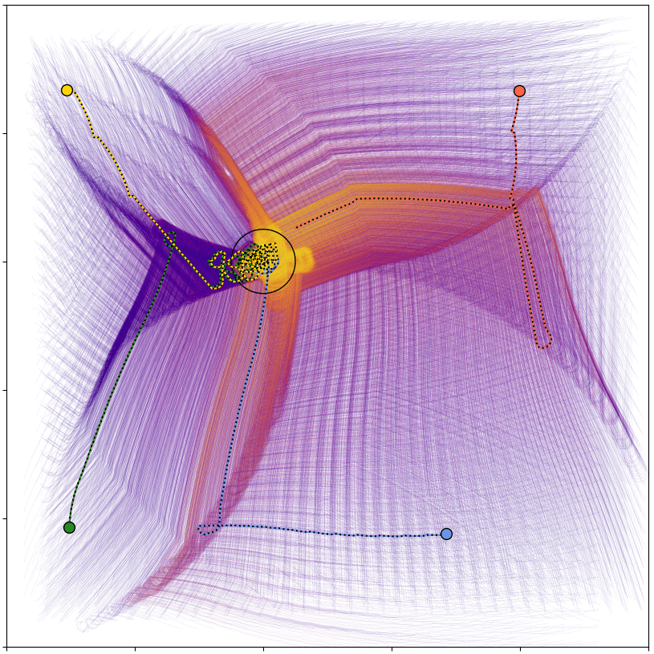
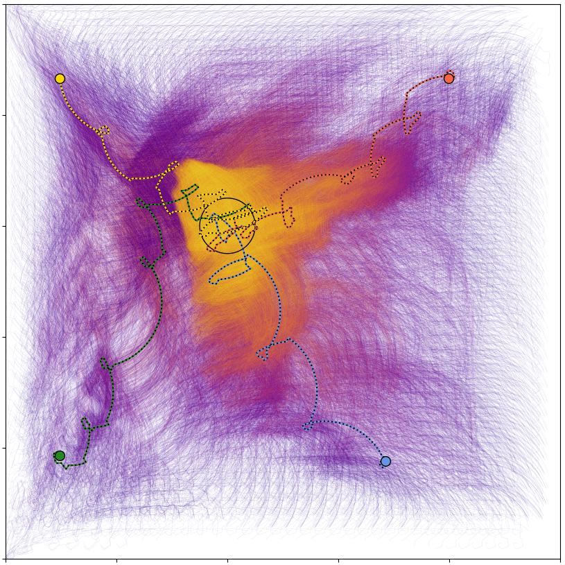
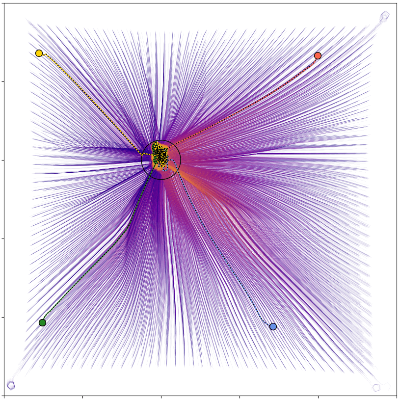
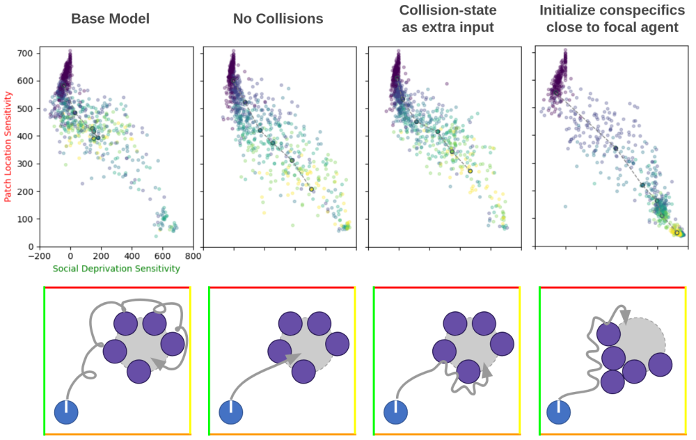
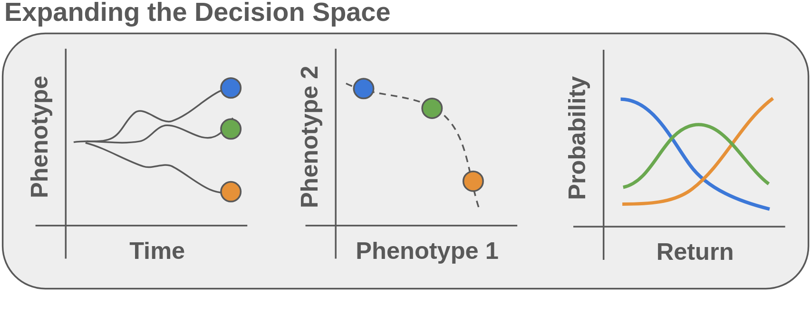
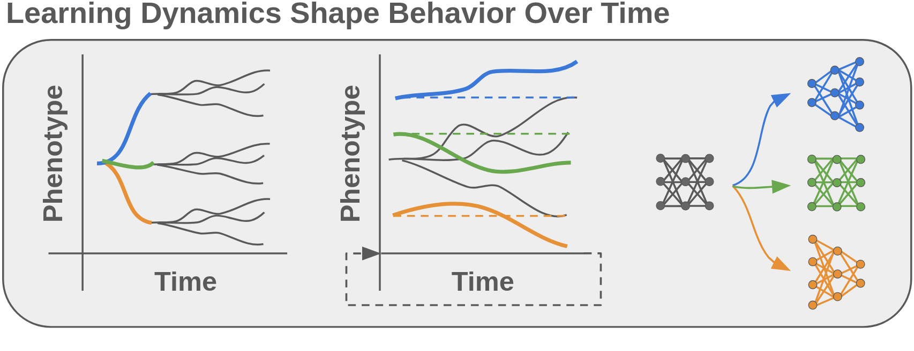
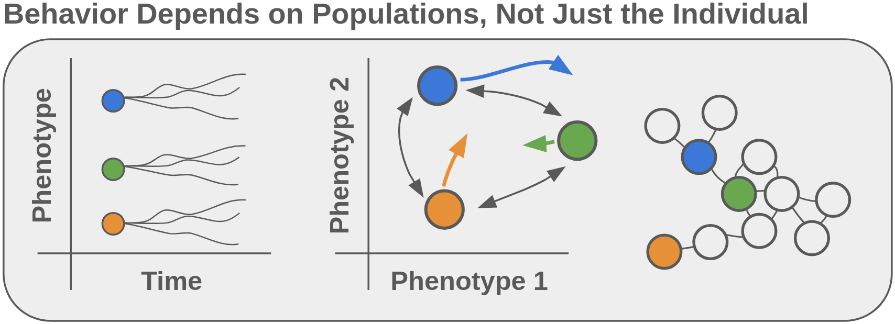
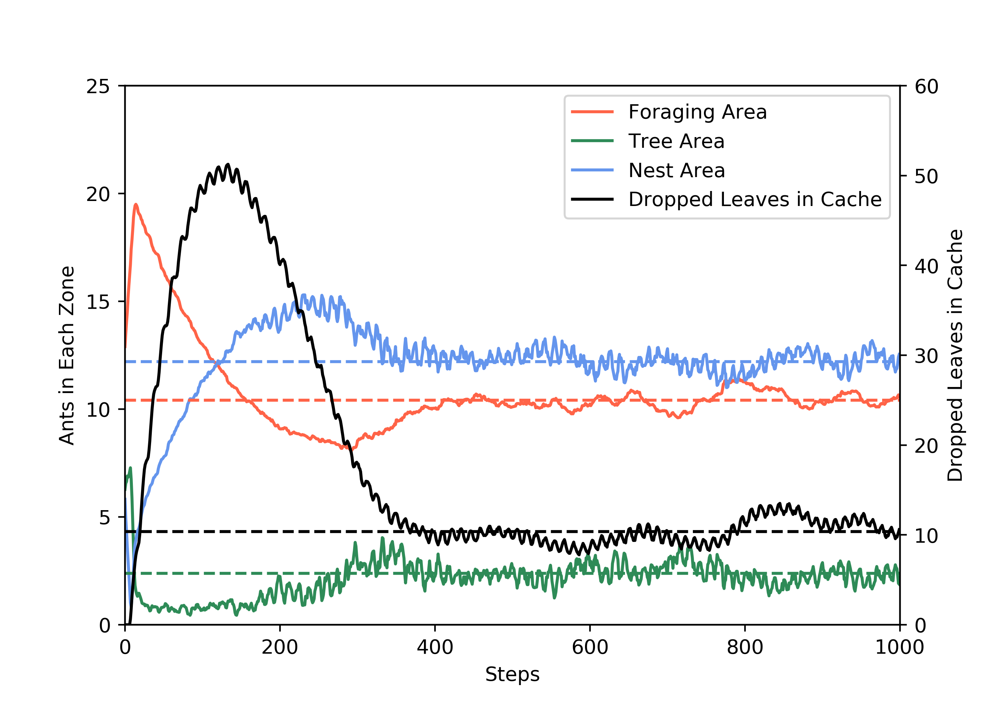
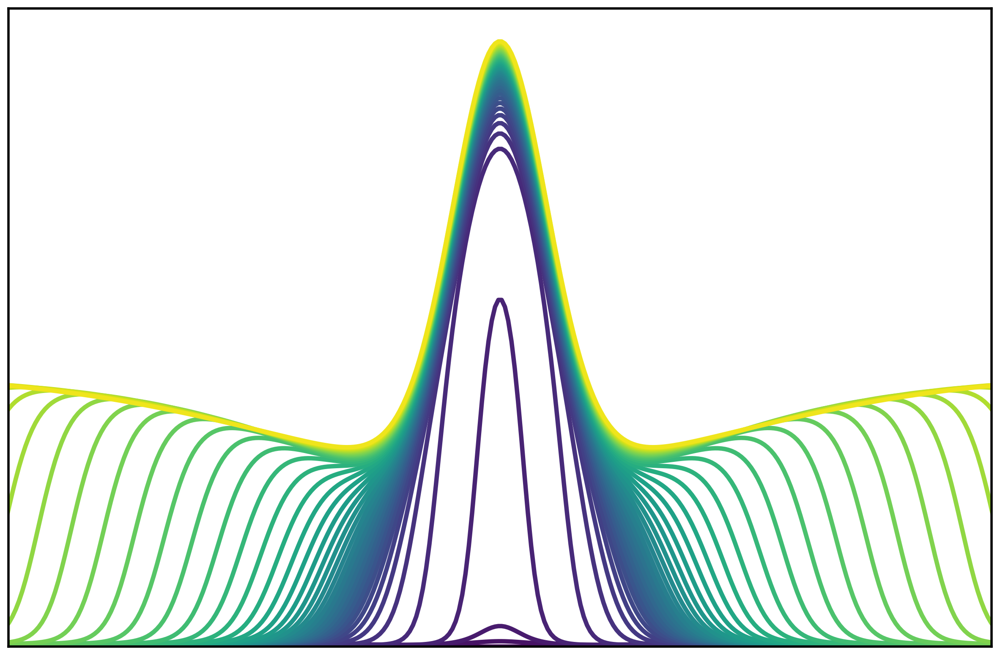

 

# [Visuospatial Route-Based Navigation](https://pgovoni21.github.io/projects/visual-route-nav)

 

# [Spatial-Social Tradeoff in Visual Navigation](https://pgovoni21.github.io/projects/social-nav)

 

# [From Optimal Policies to Individual Differences: Rethinking Reinforcement Learning for Biology](https://pgovoni21.github.io/projects/position-indiv-diff)

 

# [Evolution of Task-Partitioning in Leaf-Cutter Ants](https://pgovoni21.github.io/projects/ants-task-partitioning-ABM)

 

# [Bistable Traveling Fronts](https://pgovoni21.github.io/projects/ABK-bistability-trav-front)

