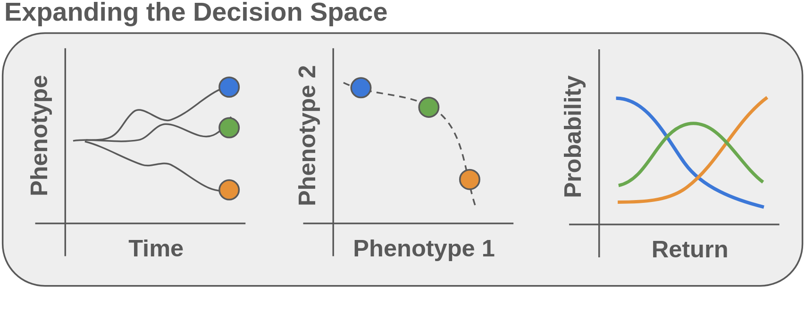
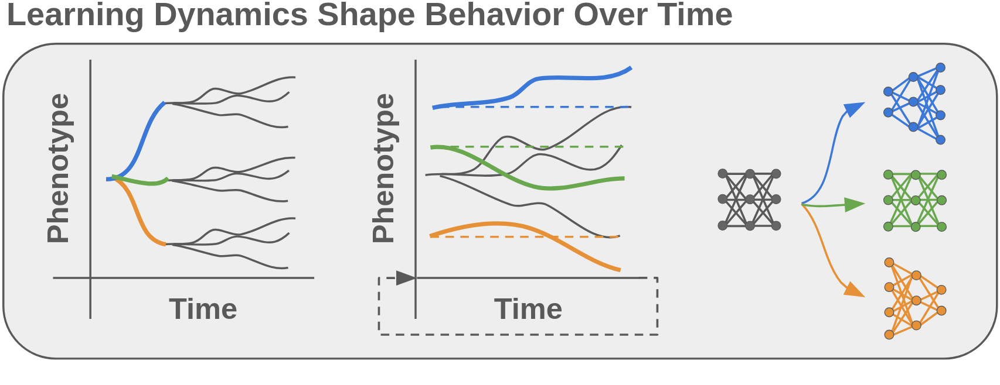
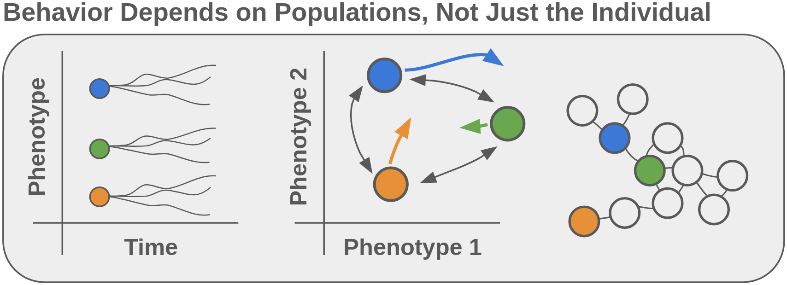

Group collaboration position paper.  
On an underreported/understudied gap between reinforcement learning and biology.

<b>Authors:</b> Patrick Govoni1, Palina Bartashevich2,3, Clémence Bergerot1, Valerii Chirkov1,3, Valentin Lecheval1,3, Pawel Romanczuk1,3,4  
<b>Affiliations:</b> <i>1</i> Institute for Theoretical Biology, Humboldt Universität zu Berlin, <i>2</i> Faculty of Life Sciences, Thaer-Institute for Agricultural and Horticultural Sciences, Humboldt Universität zu Berlin, <i>3</i> Science of Intelligence, Cluster of Excellence, <i>4</i> Bernstein Center for Computational Neuroscience  
<b>Year:</b> 2026

[Paper](https://link.springer.com/chapter/10.1007/978-3-032-39953-3_21)  

<b>Abstract:</b>

Reinforcement learning (RL) is primarily known as a computational method for optimizing control tasks, but it is increasingly used to explain biological behavior. While RL successfully captures key aspects of biology, a major gap remains: between-agent behavioral variability. Consistent individual differences naturally permeate biological populations, yet RL models typically present only the single best individual or the population average. Addressing this gap requires moving beyond current practices to generate behavioral diversity using biologically plausible mechanisms. Here, we examine approaches from various subfields of RL and outline potential paths forward to close the gap between biology and simulation.

<b>Relevant Links:</b>

[Talk @ CAN Seminar Series](https://pgovoni21.github.io/talks/2026-09-28-CAN)  
[Talk @ SAB 2026](https://pgovoni21.github.io/talks/2026-10-21-SAB)  