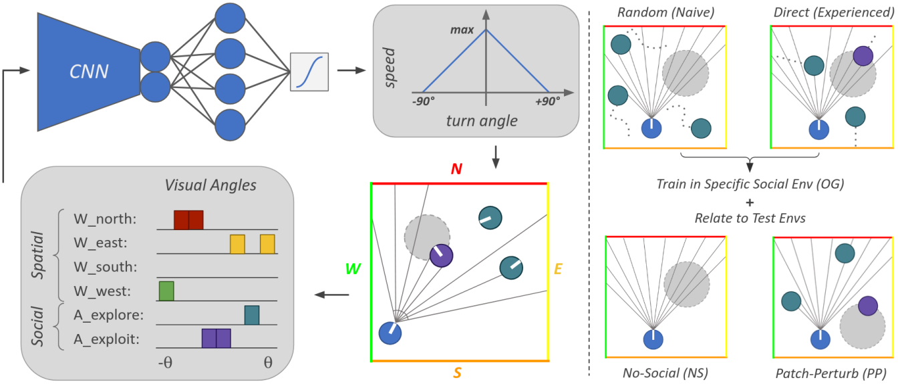
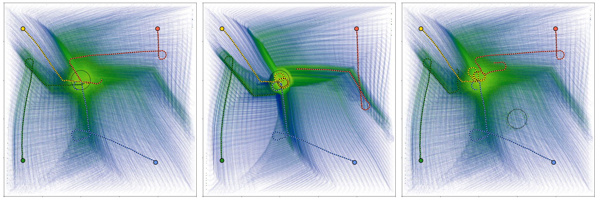
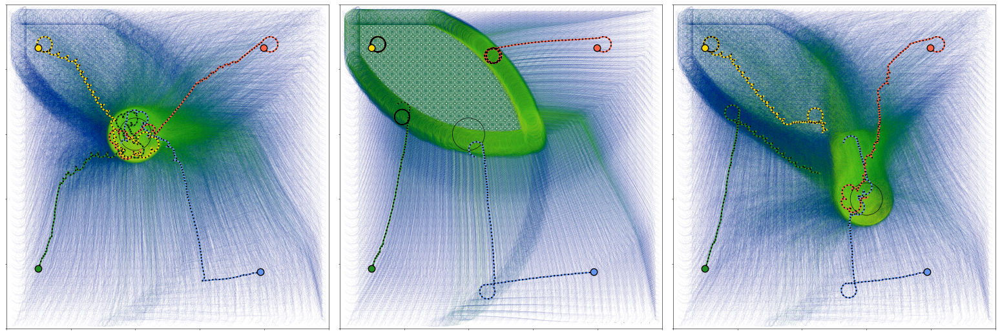
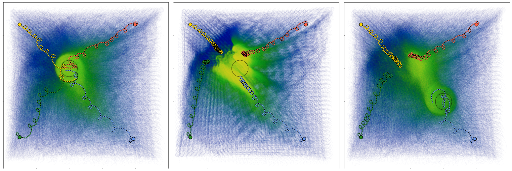
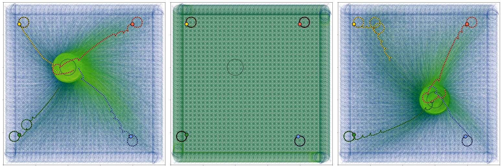
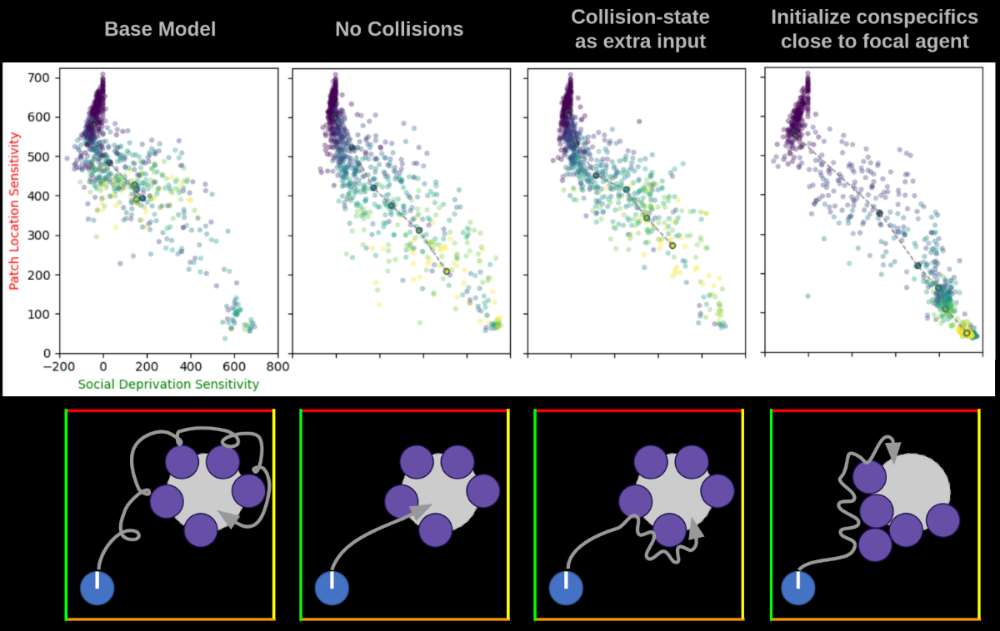

PhD Thesis - Part Two  
Characterizing a spectrum between individual-spatial and social learned navigation strategies.

<b>Author:</b> Patrick Govoni  
<b>Supervisor:</b> Pawel Romanczuk  
<b>Affiliation:</b> Institute for Theoretical Biology, Humboldt Universität zu Berlin  
<b>Group:</b> [Collective Information Processing Lab](http://lab.romanczuk.de/)  
<b>Years:</b> 2025-Present

[Preprint](https://arxiv.org/abs/2607.07460)  
[Github Repo](https://github.com/pgovoni21/vis-nav-abm)  

<b>Abstract:</b>

Navigation for social organisms rarely is a fully independent activity. Group structure and dynamics, as well as embodied interactions, critically influence useful behavior. Individual neural network controlled agents are trained to navigate in different social contexts, where social dependence and behavioral strategy learned is determined by relative task performance and spatial effect. Increasing high quality social information drives phase transitions from individual to following navigational strategy, and to collision avoidance in response to a crowded foraging patch. Predictable, nonstationary environmental dynamics drive behavioral hybridization between individual and social navigation, far and near the patch. Our findings challenge the approach of only inspecting individual behavior for social organisms and highlight the importance of taking a bottom-up approach in understanding how organisms behave.

# Individual (Only Spatial Info)

# Hybrid

# Hybrid + Patch Crowding

# Follower (Only Social Info)

# Universal Spatial-Social Tradeoff + Model-Specific Collision Avoidance

<b>Relevant Links:</b>

[Talk @ EI 2026](https://pgovoni21.github.io/talks/2026-03-19-EI)  